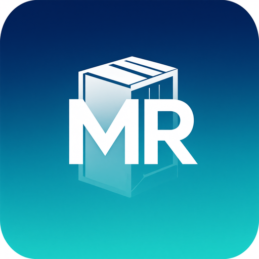

# 📦 MR Logística

**Sistema desktop completo de gestão comercial para pequenas operações de logística e varejo:**
PDV com leitor de código de barras, estoque com lotes e validade, contas a receber/pagar,
caixa diário, relatórios com exportação para Excel/PDF e backup — **100% offline, sem servidor,
sem instalação e sem mensalidade**.



> O programa foi inspirado na simplicidade de operação de ERPs como TOTVS Protheus e SAP
> Business One, mas pensado para quem precisa de **um único arquivo executável** que abre
> com dois cliques. Não há integração com Sefaz, nota fiscal ou qualquer serviço externo:
> os dados ficam **somente no seu computador**, num banco SQLite.

---

## ⬇️ Como baixar e usar (sem instalar nada)

1. Abra a página **Releases** do repositório (menu lateral direito → *Releases*) ou use o
   link direto da última versão;
2. Em **Assets**, clique no arquivo do seu sistema:
   * **Windows:** `MRLogistica-Windows-x64.exe` ← o mais usado;
   * **Linux:** `MRLogistica-Linux-x64`;
   * **macOS:** `MRLogistica-macOS.zip`;
3. **Dois cliques** no arquivo baixado. Pronto — não há instalador, não há internet envolvida;
4. No Windows, o SmartScreen pode avisar que o editor é desconhecido: clique em
   **“Mais informações” → “Executar assim mesmo”** (é o comportamento normal de qualquer
   executável novo, não é um problema do sistema);
5. Primeiro acesso: usuário **`admin`**, senha **`admin`**. Troque a senha em
   **Cadastros → Usuários** (o sistema exige uma nova senha no primeiro login).

O executável é *portável*: você pode deixá-lo na Área de Trabalho, numa pasta qualquer ou num
pendrive. Os **dados** (banco, fotos e backups) ficam separados, na pasta do usuário:

| Sistema | Pasta de dados |
|---|---|
| Windows | `C:\Usuários\<você>\.mrlogistica` |
| Linux | `~/.mrlogistica` |
| macOS | `~/.mrlogistica` |

Para levar o sistema para outro computador: copie essa pasta inteira, **ou** use
**Ferramentas → Backup e restauração → Criar backup** e restaure no destino.

---

## 🧭 O que o sistema faz

### Operação
* **Painel** — indicadores do dia e do mês (faturamento, ticket médio, lucro, contas vencidas,
  alerta de estoque baixo e de lotes vencendo), com gráficos e atalhos.
* **PDV (F2)** — venda rápida com **leitor de código de barras USB** (bipou, entrou; bipou de
  novo, soma a quantidade), busca por nome, unidades de venda (un, cx, pct, dz, kg, g, l, ml…),
  venda fracionada (ex.: 250 g de um produto cadastrado em kg), desconto por item e por venda,
  pagamento em **dinheiro, Pix, débito, crédito, fiado ou misto**, cálculo de troco,
  venda suspensa/retomada e impressão de **recibo não fiscal**.
* **Vendas (F3)** — histórico cupom a cupom, cancelamento com motivo e **devolução**
  (total ou parcial, com retorno automático ao estoque).
* **Caixa (F4)** — abertura com fundo de troco, sangria, suprimento, despesas do dia,
  fechamento com contagem e quebra de caixa, e impressão do fechamento.

### Cadastros
* **Produtos (F5)** — código interno, código de barras, foto, categoria, marca, fornecedor,
  preço de custo/venda, margem, estoque atual/mínimo, unidades e fator de conversão.
* **Categorias, Clientes (F6), Fornecedores e Usuários** — com perfis e permissões
  (administrador, gerente e vendedor) e bloqueio automático por inatividade.

### Estoque
* **Movimentações (F7)** — entradas, saídas e histórico completo por produto/lote;
* **Ajuste de inventário** — contagem física com aplicação das diferenças e auditoria de saldos;
* **Lotes e validade** — controle por lote com alerta de vencimento configurável.

### Financeiro
* **Contas a receber (F8)** — o fiado do PDV vira título automaticamente; recebimento parcial,
  quitação, prorrogação de vencimento, cancelamento, aging (faixas de atraso) e ranking de
  devedores, com comprovante em PDF;
* **Contas a pagar (F9)** — despesas por categoria/fornecedor, pagamento parcial com baixa no
  caixa, bloqueio de pagamento em dinheiro acima do que há na gaveta, resumo por competência
  e por caixa.

### Ferramentas
* **Relatórios (F10)** — **21 relatórios** prontos (vendas por dia/produto/forma/vendedor,
  produtos mais vendidos, lucro mensal, curva ABC, estoque atual e baixo, movimentações,
  lotes, fluxo de caixa, fechamentos, despesas, contas, clientes, fornecedores, produtos e
  usuários) com filtros por período e **exportação para Excel (.xlsx), PDF e CSV**, além de
  impressão direta;
* **Etiquetas (F11)** — gera **código de barras interno EAN-13** para produtos sem código e
  imprime etiquetas em folha adesiva (Pimaco 6180/6182/6183/6080) ou rolo térmico, com preço,
  código interno e marca opcionais, pré-visualização e quantidade por produto;
* **Backup e restauração** — backup com um clique, verificação de integridade, visão do
  conteúdo antes de restaurar, cópia de segurança automática antes de qualquer restauração,
  limpeza dos backups antigos e backup automático ao abrir/fechar;
* **Configurações (F12)** — dados da empresa e do recibo, tema claro/escuro, regras de venda,
  bipador, alertas, tabela completa de atalhos e **diagnóstico dos dados** (integridade do
  banco, saldos divergentes, duplicados etc.).

---

## 🔌 Leitor de código de barras (bipador)

Qualquer leitor USB que funcione como **teclado** (keyboard-wedge — praticamente todos os do
mercado) funciona sem configuração:

1. Conecte o leitor; o Windows o reconhece como um teclado;
2. No **PDV**, o cursor já nasce no campo de código: é só bipar;
3. Bipar um código **desconhecido** abre o cadastro rápido do produto já preenchido com o
   código lido — cadastre e o item entra na venda em seguida;
4. Para produtos **sem código de barras**, use **Etiquetas (F11)**: o sistema gera um EAN-13
   interno (faixa 200–299, reservada para uso da própria loja) e imprime as etiquetas.

---

## ⌨️ Atalhos de teclado

| Tecla | Ação | Tecla | Ação |
|---|---|---|---|
| F1 | Ajuda/atalhos | Ctrl+B | Focar a busca |
| F2 | PDV | Ctrl+R | Recarregar a tela |
| F3 | Vendas | Ctrl+N | Novo registro / nova venda |
| F4 | Caixa | Ctrl+E | Exportar (Excel/PDF/CSV) |
| F5 | Produtos | Ctrl+P | Imprimir |
| F6 | Clientes | Ctrl+T | Tema claro/escuro |
| F7 | Estoque | Ctrl+L | Bloquear a tela |
| F8 | Contas a receber | Ctrl+U | Trocar de usuário |
| F9 | Contas a pagar | Esc | Fechar diálogos |
| F10 | Relatórios | Duplo clique | Abrir/editar registro |
| F11 | Etiquetas | | |
| F12 | Configurações | | |

No PDV: `Enter` bipa/adiciona, `F2` busca por nome, `F3` quantidade, `F4` preço, `F5` desconto
do item, `F6` desconto da venda, `F7` cliente, `F8` exclui item, `F9` limpa, `F10` suspende,
`F12` finaliza, `+`/`-` ajustam a quantidade.

---

## 🖥️ Requisitos

| | |
|---|---|
| Windows | Windows 10 ou 11 (64 bits) — **nada mais é necessário** |
| Linux | Qualquer distribuição com glibc recente |
| macOS | 11 ou superior |
| Memória | 2 GB recomendados |
| Internet | **Não usa** (nem para instalar, nem para funcionar) |
| Impressora | Qualquer impressora do sistema (recibos 58/80 mm, A4 e etiquetas) |

---

## 👩‍💻 Para desenvolvedores

### Rodar a partir do código-fonte

```bash
git clone https://github.com/rafaellfsouza/mr-logistica.git
cd mr-logistica
python -m venv .venv && source .venv/bin/activate   # Windows: .venv\Scripts\activate
pip install -r requirements.txt                      # Linux: sudo apt install python3-tk antes
python run.py                                        # ou: python -m mrlog
```

### Testes automatizados (não precisam de tela aberta)

```bash
python tests/smoke_test.py                                   # camada de dados (15 cenários)
xvfb-run -a python tests/gui_test.py                         # TODAS as telas da interface
xvfb-run -a python tests/gui_test.py pdv financeiro          # só algumas telas
```

O teste de interface abre a aplicação real num display virtual, navega pelas **18 telas**,
faz vendas no PDV, movimenta estoque, recebe títulos, exporta relatórios em Excel/PDF/CSV,
gera etiquetas e **restaura um backup de verdade** — e falha se qualquer janela der erro.

### Gerar o executável em casa

```bash
pip install -r requirements-dev.txt
# Windows:
scripts\build_windows.bat
# Linux:
./scripts/build_linux.sh
# macOS:
./scripts/build_macos.sh
```

O resultado fica em `dist/` (`MRLogistica.exe`, `MRLogistica` ou `MRLogistica.app`).
O spec do PyInstaller (`mrlogistica.spec`) embute o ícone e as dependências num arquivo único.

### Publicação automática (GitHub Actions)

* **`ci.yml`** — a cada push no branch principal roda os dois testes acima;
* **`release.yml`** — quando você cria uma tag `vX.Y.Z`, o GitHub compila o executável em
  Windows, Linux e macOS e **publica a Release com os três arquivos para download**:

```bash
git tag v1.1.0 && git push origin v1.1.0
```

---

## 🗂️ Estrutura do projeto

```
mr-logistica/
├── run.py                  # ponto de entrada (python run.py)
├── mrlogistica.spec        # empacotamento PyInstaller (arquivo único)
├── requirements.txt        # dependências de execução
├── requirements-dev.txt    # + PyInstaller e pytest
├── assets/                 # ícone do aplicativo (ico/png/icns)
├── scripts/                # scripts de build por sistema
├── .github/workflows/      # CI (testes) e Release (executáveis)
├── tests/                  # smoke_test.py e gui_test.py
└── mrlog/
    ├── banco.py            # conexão SQLite, migrações e transações
    ├── esquema.py          # criação/evolução do banco (todas as tabelas)
    ├── produtos.py, estoque.py, unidades.py, vendas.py, caixa.py,
    ├── clientes.py, fornecedores.py, categorias.py, usuarios.py,
    ├── contas_receber.py, contas_pagar.py, formas_pagamento.py,
    ├── relatorios.py, exportacao.py, impressao.py, etiquetas.py,
    ├── codigobarras.py     # EAN-13/CODE128 desenhados sem bibliotecas externas
    ├── backup.py, configuracoes.py, painel.py, caminhos.py, utils.py
    └── gui/                # interface Tkinter (tema, widgets, diálogos e 18 telas)
```

---

## ✅ O que configurar depois de instalar (checklist)

1. **Configurações → Empresa e recibo:** nome, CNPJ/CPF, endereço e a mensagem do recibo;
2. **Cadastros → Usuários:** troque a senha do `admin` e crie os vendedores (com permissões);
3. **Cadastros → Categorias e Produtos:** importe/comece o cadastro; use *Etiquetas* para
   gerar códigos e imprimir as etiquetas dos produtos sem código de barras;
4. **Operação → Caixa:** abra o caixa com o fundo de troco antes da primeira venda;
5. **Ferramentas → Configurações → Backup:** confirme o backup automático e quantos backups
   manter (o padrão é 10);
6. **Impressora:** defina a impressora padrão do sistema (recibo 58/80 mm ou A4) e, se usar
   folha adesiva, escolha o modelo em *Etiquetas*.

---

## ❓ Perguntas frequentes

**O antivírus/SmartScreen bloqueou o arquivo.** É o aviso padrão para executáveis novos e
sem assinatura digital. Libere uma exceção ou clique em “Executar assim mesmo”. O código-fonte
completo está neste repositório para auditoria.

**Posso usar em mais de um computador?** Cada máquina tem o seu banco local. Para compartilhar
dados, faça backup em um e restaure no outro (ou mantenha a pasta `.mrlogistica` num pendrive
apontando a variável de ambiente `MRLOG_DATA_DIR`). Não há sincronização em nuvem embutida.

**Emiti nota fiscal?** Não. O MR Logística imprime **recibo não fiscal** e relatórios gerenciais;
não há e não haverá integração com Sefaz/NFe — essa foi uma decisão de projeto.

**Perdi o banco / formatar o PC.** Use *Backup e restauração* a partir de um backup antigo;
toda restauração cria antes uma cópia de segurança do banco atual (`antes-da-restauracao-*.db`).

**Onde vejo erros estranhos?** Em `~/.mrlogistica/erro-ultimo.txt` fica o registro do último
erro inesperado, útil para suporte.

---

Feito com Python + Tkinter (interface), SQLite (dados), Pillow (etiquetas/fotos),
openpyxl (Excel) e reportlab (PDF). Nenhum dado sai do seu computador.
